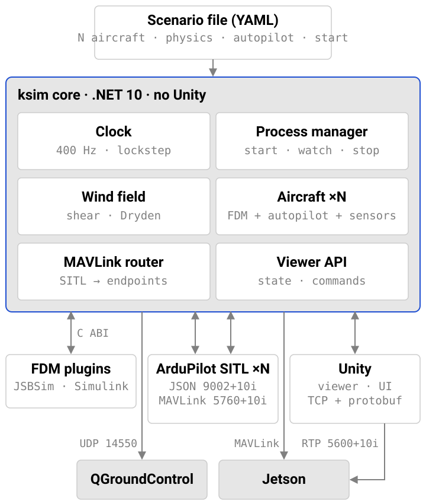
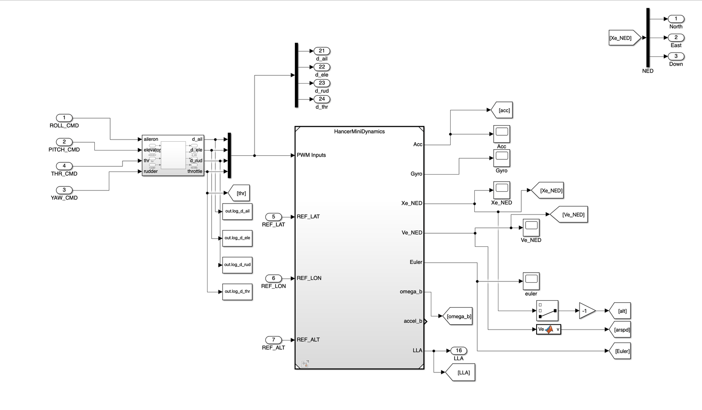
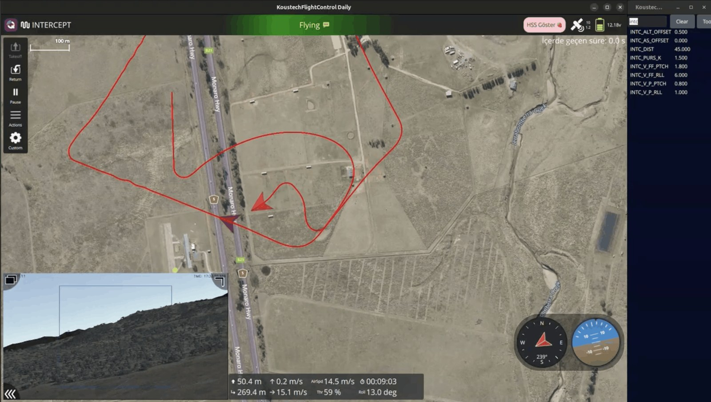

## Goal

Test autonomous flight, locking and evasion algorithms against the real autopilot software without risking the aircraft or going to the field. The simulator is the team's main test tool.

## From the first version to the second

In the first version, physics, the ArduPilot link and process management lived inside Unity. Only a few people could set it up and run it, a second aircraft had to be added by hand, and when Unity crashed the aircraft fell too. In the second version I moved everything that does not need Unity into a separate core (ksim) on .NET 10. Unity is now only the viewer and the UI.



## How it works

- **The scenario file is the single source of truth.** Aircraft count, aircraft type, physics engine, autopilot, start position and camera are defined in YAML. The UI edits this file, and the same file runs from the command line.
- **One-click start.** Pressing Start launches an ArduPilot SITL process for each aircraft, generates its parameter file and separates each aircraft with `--sysid`. QGroundControl and the Jetson can then connect.
- **Port rule.** For aircraft *i*, every port is `base + 10·i`. Nothing collides, and which aircraft is on which port is predictable.
- **Physics plugins.** JSBSim and Simulink are native plugins implementing the same C ABI. The ArduPilot JSON protocol, sensor noise, wind and initial conditions are written once in the core and run the same whichever physics engine is chosen. Simulink Coder output plugs into this ABI through a wrapper template. Struct sizes are pinned with `static_assert` on the C side and a test on the C# side.
- **Unity is a client.** It talks to the core over TCP + protobuf, and the aircraft keep flying if Unity closes. It renders the sensor cameras and hands them to ffmpeg as RTP streams for the Jetson, writing the SDP file automatically.
- **Headless.** The core is tested with `dotnet test` without opening Unity. It runs on macOS arm64 and Ubuntu x86_64. There are 299 tests, and CI flies a smoke test with two Hançer aircraft on every change.

## Scheduler

Physics runs in lockstep at 400 Hz. Because `Thread.Sleep(1)` sleeps with millisecond resolution, the loop burned the remaining time spinning. With microsecond sleeps (`nanosleep`) and the macOS time-constraint thread policy, CPU use dropped and no tick was missed.

```bars max=100 CPU use of the ksim core at 400 Hz on a MacBook Pro M3 Pro. Zero dropped ticks in every run.
1 aircraft · before | 51.2 | 51.2%
1 aircraft · after | 7 | 7.0% | *
10 aircraft · before | 57.6 | 57.6%
10 aircraft · after | 28.9 | 28.9% | *
30 aircraft · before | 81.8 | 81.8%
30 aircraft · after | 40.1 | 40.1% | *
```



## HITL

I designed the HITL extension's architecture and wrote its technical documentation: simulation outputs go to an STM32, which turns them into sensor signals for a real Pixhawk. A teammate implemented it from that document. The hardware was not produced in time, so HITL could not be fully tested. The new core's autopilot interface is designed so that HITL plugs in where SITL does.

```pipeline HITL (design and documentation: me · implementation: a teammate)
Simulator | physics + sensor model
STM32 | sensor emulation
Pixhawk | real flight controller
```


