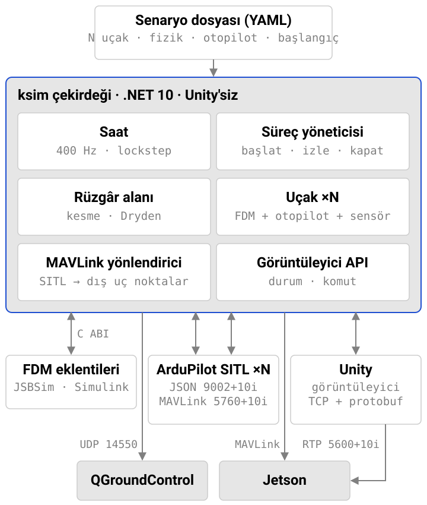
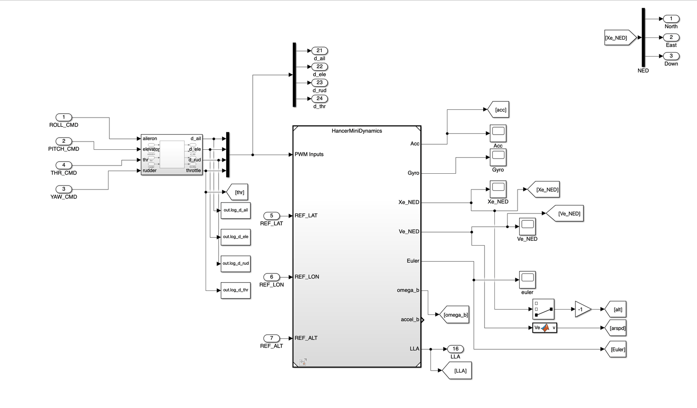

## Amaç

Otonom uçuş, kilitlenme ve kaçınma algoritmalarını, uçağı riske atmadan ve sahaya çıkmadan, gerçek otopilot yazılımına karşı test etmek. Simülasyon takımın ana test aracı.

## İlk sürümden ikinciye

İlk sürümde fizik, ArduPilot bağlantısı ve süreç yönetimi Unity'nin içindeydi. Simülasyonu sadece birkaç kişi kurup çalıştırabiliyordu, ikinci bir uçak elle ekleniyordu ve Unity çökünce uçaklar da düşüyordu. İkinci sürümde Unity'ye bağlı olmayan her şeyi .NET 10 üzerinde ayrı bir çekirdeğe (ksim) taşıdım. Unity artık sadece görüntüleyici ve arayüz.



## Nasıl çalışıyor

- **Senaryo dosyası tek doğru kaynak.** Uçak sayısı, uçak tipi, fizik motoru, otopilot, başlangıç konumu ve kamera YAML'da tanımlı. Arayüz bu dosyayı düzenliyor, aynı dosya komut satırından da çalışıyor.
- **Tek tıkla başlatma.** Başlat'a basınca her uçak için ArduPilot SITL süreci kendiliğinden açılıyor, parametre dosyası üretiliyor ve her uçak `--sysid` ile ayrışıyor. QGroundControl ve Jetson bağlanabilir hale geliyor.
- **Port kuralı.** Uçak *i* için her port `taban + 10·i`. Çakışma olmuyor, hangi uçağın hangi portta olduğu tahmin edilebiliyor.
- **Fizik eklentileri.** JSBSim ve Simulink aynı C ABI'yi uygulayan native eklentiler. ArduPilot JSON protokolü, sensör gürültüsü, rüzgâr ve başlangıç koşulları çekirdekte bir kez yazılı, hangi fizik motoru seçilirse seçilsin aynı kod çalışıyor. Simulink Coder çıktısı bir wrapper şablonuyla bu ABI'ye takılıyor. Struct boyutları C tarafında `static_assert`, C# tarafında test ile sabit.
- **Unity istemci.** Çekirdekle TCP + protobuf üzerinden konuşuyor. Unity kapansa da uçaklar uçmaya devam ediyor. Sensör kameralarını render edip ffmpeg ile RTP akışı olarak Jetson'a veriyor, SDP dosyası otomatik yazılıyor.
- **Headless çalışma.** Çekirdek Unity açılmadan `dotnet test` ile test ediliyor. macOS arm64 ve Ubuntu x86_64'te çalışıyor. 299 test var, CI her değişiklikte iki Hançer'le bir duman testi uçuruyor.

## Zamanlayıcı

Fizik 400 Hz'de lockstep çalışıyor. `Thread.Sleep(1)` milisaniye çözünürlüğünde uyuduğu için döngü kalan süreyi boşta dönerek harcıyordu. Mikrosaniye uykusu (`nanosleep`) ve macOS'ta zaman kısıtlı (time-constraint) thread ilkesiyle CPU kullanımı düştü, hiç tik kaçırılmadı.

```bars max=100 ksim çekirdeğinin CPU kullanımı, 400 Hz, MacBook Pro M3 Pro. Tüm ölçümlerde 0 düşen tik.
1 uçak · önce | 51.2 | %51.2
1 uçak · sonra | 7 | %7.0 | *
10 uçak · önce | 57.6 | %57.6
10 uçak · sonra | 28.9 | %28.9 | *
30 uçak · önce | 81.8 | %81.8
30 uçak · sonra | 40.1 | %40.1 | *
```



## HITL

HITL eklentisinin mimarisini tasarlayıp teknik dokümantasyonunu yazdım: simülasyon çıktıları bir STM32'ye gidiyor, STM32 bunları gerçek bir Pixhawk için sensör sinyallerine çeviriyor. Bir takım arkadaşım bu dokümandan uyguladı. Donanım zamanında üretilemediği için HITL sahada tam olarak test edilemedi. Yeni çekirdeğin otopilot arayüzü, HITL'in SITL ile aynı yere takılacağı şekilde tasarlandı.

```pipeline HITL (tasarım ve dokümantasyon: ben · uygulama: takım arkadaşım)
Simülatör | fizik + sensör modeli
STM32 | sensör emülasyonu
Pixhawk | gerçek uçuş kontrolcüsü
```


