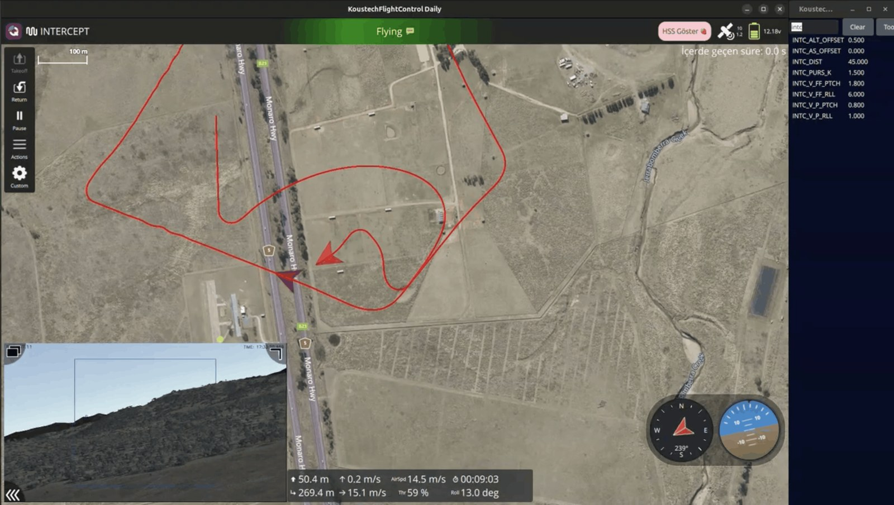

## Amaç

Otonom uçuş algoritmalarını, uçağı riske atmadan ve sahaya çıkmadan, gerçek otopilot yazılımına karşı test etmek.

## Mimari

```pipeline SITL: otopilot yazılımı simüle edilen uçağı gerçekmiş gibi uçurur
Simulink | uçuş dinamiği modeli
Simulink Coder | gömülü C kodu üretimi
Unity | fizik + 3B görselleştirme
UDP (JSON) |
ArduPilot SITL | otopilot yazılımı
```

```pipeline HITL eklentisi (tasarım ve dokümantasyon: ben · uygulama: takım arkadaşım)
Unity | simülasyon çıktıları
STM32 | sensör emülasyonu
Pixhawk | gerçek uçuş kontrolcüsü
```


## Ne yaptım

- Simulink uçuş dinamiği modelini Simulink Coder ile C'ye çevirip Unity'ye gömdüm. Unity fiziği bu kodla çalıştırıyor ve 3B görselleştirmeyi sağlıyor.
- Unity'yi UDP üzerinden ArduPilot SITL'e bağladım. Böylece otopilot yazılımı simüle edilen uçağı gerçekmiş gibi uçuruyor.
- HITL eklentisinin mimarisini tasarlayıp teknik dokümantasyonunu yazdım: simülasyon çıktıları bir STM32'ye gidiyor, STM32 bunları gerçek bir Pixhawk için sensör sinyallerine çeviriyor. Bir takım arkadaşım bu dokümandan uyguladı.



## Durum

Algoritma testleri SITL üzerinde çalışıyor. HITL altyapısı hazır, ancak donanım zamanında üretilemediği için tam olarak test edilemedi.
