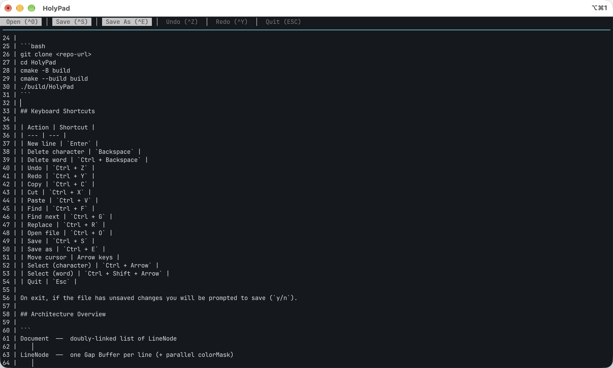

## Goal

A text editor that runs entirely in the terminal, with no GUI libraries and keyboard-only control, where the cost of in-line editing and screen rendering does not depend on document size.

## Architecture

```pipeline Input and editing
Keyboard input | termios raw mode, poll(), SIGWINCH
CommandStack | undo / redo
Document | doubly linked list of lines
LineNode | one gap buffer per line
```

```pipeline Rendering
Renderer | one buffer, one write, dirty flag
Viewport | visible rows only
Terminal | VT100 alternate screen
```

## My part

I wrote the editor's core: the gap buffer, line nodes and document, the renderer, the viewport, the input manager, the undo/redo command stack, file open/save and the file explorer. My teammate added the keyboard shortcuts, search, replace, jumping between matches and clipboard operations. I fixed the false matches in the KMP search.

- Hybrid data structure: each line is a gap buffer and lines are nodes in a doubly linked list. Typing is O(1) amortized; splitting and merging lines is an O(1) pointer splice.

.")

 pointer change. None of the following lines move.")

## Other technical features of the project

- **UTF-8 / Turkish support:** multi-byte characters are handled at the byte level (0xC0 / 0x80 continuation-byte detection), so cursor movement and deletion respect character boundaries.
- **Viewport-based rendering:** only the visible area is drawn, so render cost does not depend on the total line count. Each frame is built in one memory buffer and written once; a dirty flag redraws only when something changes.
- **Undo / redo:** Command pattern with character, word and line commands; a full-document snapshot for clipboard operations.
- **Other:** in-line search and replace with KMP, ANSI-coloured selection, and a file explorer built on C++17 `<filesystem>` drawn as an overlay over the document.
- **POSIX terminal handling:** raw mode via termios, asynchronous input via poll(), resize via SIGWINCH, and the VT100 alternate screen buffer to preserve shell history.



## Known limitations

Search is intra-line only for now. Cut/paste and its undo deliberately rebuild the whole document from a snapshot, an O(N) trade-off for correctness. ANSI escape sequences inside opened files are not yet sanitized.
