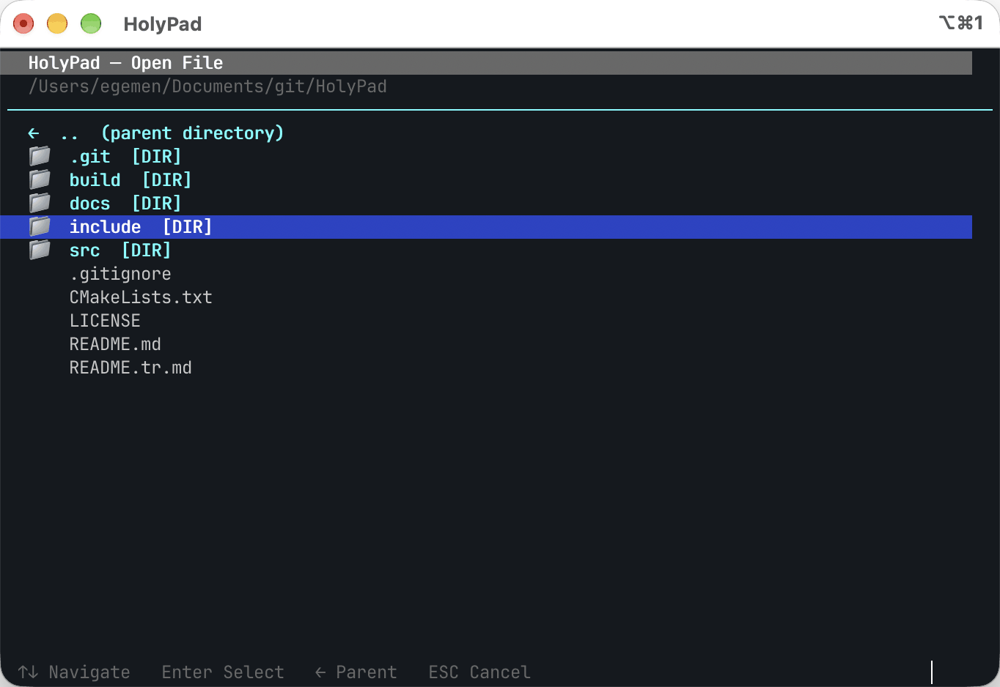

## Amaç

Tamamen terminalde çalışan, GUI kütüphanesi kullanmayan ve sadece klavyeyle kontrol edilen bir metin editörü. Satır içi düzenleme ve ekran çizim maliyeti doküman boyutuna bağlı olmamalı.

## Mimari

```pipeline Girdi ve düzenleme
Klavye girdisi | termios raw mod, poll(), SIGWINCH
Komut yığını | undo / redo
Doküman | satırların çift yönlü bağlı listesi
Satır | satır başına bir gap buffer
```

```pipeline Çizim
Renderer | tek buffer, tek write, dirty flag
Viewport | sadece görünen satırlar
Terminal | VT100 alternatif ekran
```

## Benim kısmım: veri yapısı ve backend

Veri yapısı benim tasarımımdı. Takım arkadaşım ağırlıklı olarak terminal ve arayüz tarafını yaptı.

- Hibrit veri yapısı: her satır bir gap buffer, satırlar çift yönlü bağlı listede düğüm. Yazma O(1) amortize, satır bölme ve birleştirme O(1) işaretçi değişikliği.

.")

## Projenin diğer teknik özellikleri

- **UTF-8 / Türkçe desteği:** çok baytlı karakterler bayt seviyesinde işleniyor (0xC0 / 0x80 devam baytı tespiti), imleç hareketi ve silme karakter sınırlarına uyuyor.
- **Viewport tabanlı çizim:** sadece görünen alan çiziliyor, çizim maliyeti toplam satır sayısına bağlı değil. Her kare tek bir bellek buffer'ında oluşturulup tek seferde yazılıyor, dirty flag sadece bir şey değiştiğinde yeniden çiziyor.
- **Undo / redo:** karakter, kelime ve satır komutlarıyla Command deseni. Pano işlemleri için tam doküman anlık görüntüsü.
- **Diğer:** KMP ile satır içi arama ve değiştirme, ANSI renkli seçim, C++17 `<filesystem>` üzerine kurulu ve dokümanın üstüne katman olarak çizilen dosya gezgini.
- **POSIX terminal yönetimi:** termios ile raw mod, poll() ile asenkron girdi, SIGWINCH ile yeniden boyutlandırma, shell geçmişini korumak için VT100 alternatif ekran buffer'ı.



## Bilinen kısıtlar

Arama şimdilik sadece satır içi. Kes/yapıştır ve geri alınması bilerek tüm dokümanı anlık görüntüden yeniden kuruyor: doğruluk için O(N) bir ödünleşim. Açılan dosyalardaki ANSI kaçış dizileri henüz temizlenmiyor.
