## Why

MAVSDK's multirotor focus caused problems on our fixed-wing UAV, and I could not find a good open-source MAVLink library for C#.

## Flow

```pipeline
Raw bytes | UDP or serial port
Frame parser | v1 / v2, CRC-16/X25 + CRC_EXTRA
Message registry | generated, no reflection
Typed message | a C# object
```

## Frame and CRC



- Parses MAVLink v1 (0xFE) and v2 (0xFD) frames. v2 has a 9-byte header and an optional 13-byte signature.
- CRC-16/X25 runs over the whole header except the start byte and over the payload, then the message's own CRC_EXTRA byte is added. If the two sides define the same message differently, the frame is rejected.
- `MavlinkConnection` tracks sequence numbers and provides send helpers.

## Message registry

The first version found messages at run time through `[MavMessage(Id, CrcExtra)]` attributes and reflection. I replaced that with a `FrozenDictionary` registry generated ahead of time by `MavCs.Tools`. The switch also exposed a CRC mismatch in the `ATTITUDE` message, which is now fixed.

## Tests

- CRC and payload serialisation were verified both ways over UDP against a mock drone script written with pymavlink.
- xUnit tests: round-trip serialisation of the 20 messages, CRC, v1/v2 frames, the registry and the transport layer.
- CI runs on Ubuntu and Windows with a .NET 9 and .NET 10 matrix.

## Status

A generator that builds message definitions from the MAVLink XML files is on the roadmap. The project is paused there for lack of time.
