## Neden

MAVSDK çok rotorlu araçlara odaklandığı için sabit kanatlı İHA'mızda sorun çıkardı, C# için de iyi bir açık kaynak MAVLink kütüphanesi bulamadım.

## Akış

```pipeline
Ham baytlar | UDP veya seri port
Çerçeve ayrıştırıcı | v1 / v2, CRC-16/X25 + CRC_EXTRA
Mesaj kaydı | üretilmiş, reflection yok
Tip güvenli mesaj | C# nesnesi
```

## Çerçeve ve CRC



- MAVLink v1 (0xFE) ve v2 (0xFD) çerçevelerini ayrıştırıyor. v2'de 9 baytlık başlık ve isteğe bağlı 13 baytlık imza alanı var.
- CRC-16/X25 başlangıç baytı hariç tüm başlık ve payload üzerinden hesaplanıyor, sonra mesaja özel CRC_EXTRA baytı ekleniyor. Böylece iki taraf aynı mesajı farklı tanımlıyorsa çerçeve reddediliyor.
- `MavlinkConnection` sıra numaralarını tutuyor ve gönderme yardımcıları sunuyor.

## Mesaj kaydı

İlk sürüm mesajları `[MavMessage(Id, CrcExtra)]` attribute'larıyla, çalışma anında reflection ile buluyordu. Bunu `MavCs.Tools` ile derleme öncesinde üretilen bir `FrozenDictionary` kaydıyla değiştirdim. Geçiş sırasında `ATTITUDE` mesajındaki bir CRC uyuşmazlığı da ortaya çıktı ve düzeldi.

## Test

- CRC ve payload serileştirmesi, pymavlink ile yazılmış sahte bir drone betiğine karşı UDP üzerinden iki yönlü doğrulandı.
- xUnit testleri: 20 mesajın gidiş-dönüş serileştirmesi, CRC, v1/v2 çerçeve, kayıt ve bağlantı katmanı.
- CI, Ubuntu ve Windows üzerinde .NET 9 ve .NET 10 matrisiyle çalışıyor.

## Durum

Mesaj tanımlarını MAVLink XML dosyalarından üretecek generator yol haritasında. Proje zaman yetersizliğinden orada duraklatıldı.
