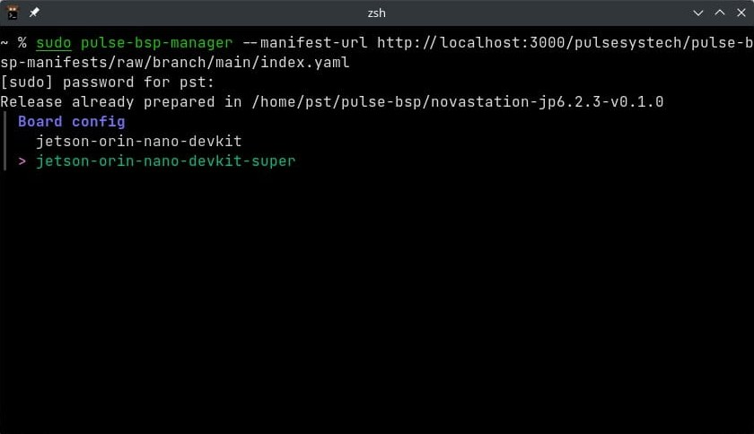

## Goal

Reduce installing the company's custom BSP for its NVIDIA Jetson carrier boards, and flashing the board, to a single step.

## Before and after

| Before (by hand) | After (Pulse BSP Manager) |
| --- | --- |
| Download the NVIDIA BSP with SDK Manager | Run a single script |
| Copy 10+ files into the right places one by one | Pick the board and version from the menu |
| Change the EEPROM read size from 0x100 to 0x0 in the board configuration | Download, extraction, installation and flashing run automatically |
| Flash the board through SDK Manager | Optionally flash several boards at once |

## Architecture

```pipeline Board definitions come from remote YAML; scripts do the rest
Remote YAML | board and version definitions
Go TUI (huh) | board and version selection from a tree
Bash scripts | download, extract, BSP layer, EEPROM patch, flash
Jetson carrier board |
```



## What I did

- Wrote the Bash scripts that download and extract the NVIDIA Jetson Linux BSP, apply the company's BSP layer on top and flash the board.
- Wrote the TUI with Go's huh library: it fetches board and version definitions as remote YAML, builds a tree and lets the user choose. Adding a new board or version only requires updating the YAML.
- Automated the EEPROM read-size patch needed because the custom carrier board lacks the EEPROM found on NVIDIA's reference board.
- Added mass-flash support, so several carrier boards can be flashed at once, and support for JetPack 6 and 7.

## Now

Learning Linux kernel configuration and custom kernel builds (`make menuconfig`) under the CTO's mentorship.
