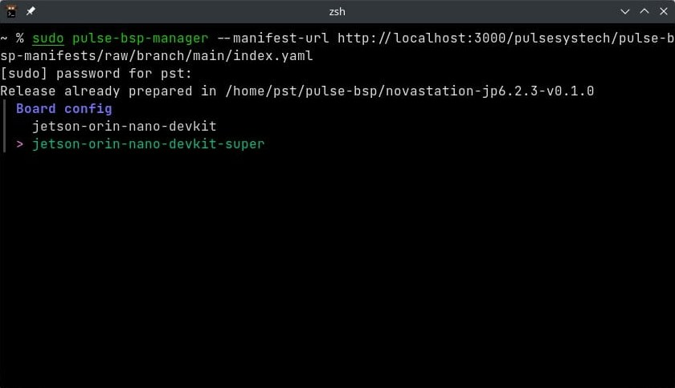

## Amaç

Şirketin NVIDIA Jetson taşıyıcı kartları için özel BSP'sinin kurulumunu ve kartın flash'lanmasını tek adıma indirmek.

## Önce ve sonra

| Önce (elle) | Sonra (Pulse BSP Manager) |
| --- | --- |
| NVIDIA BSP'yi SDK Manager ile indir | Tek bir script çalıştır |
| 10'dan fazla dosyayı tek tek doğru yerlere kopyala | Menüden kartı ve sürümü seç |
| Kart yapılandırmasında EEPROM okuma boyutunu 0x100'den 0x0'a çevir | İndirme, açma, kurulum ve flash otomatik çalışır |
| Kartı SDK Manager ile flash'la | İstenirse birden çok kartı aynı anda flash'la |

## Mimari

```pipeline Kart tanımı uzaktaki YAML'dan gelir, gerisi script'lerle otomatik
Uzak YAML | kart ve sürüm tanımları
Go TUI (huh) | ağaçtan kart ve sürüm seçimi
Bash script'leri | indirme, açma, BSP katmanı, EEPROM yaması, flash
Jetson taşıyıcı kart | 
```



## Ne yaptım

- NVIDIA Jetson Linux BSP'sini indirip açan, şirketin BSP katmanını üzerine uygulayan ve kartı flash'layan Bash script'lerini yazdım.
- Go'nun huh kütüphanesiyle TUI'yi yazdım: kart ve sürüm tanımlarını uzaktaki YAML'dan çekiyor, bir ağaç kurup kullanıcıya seçtiriyor. Yeni bir kart ya da sürüm eklemek için sadece YAML'ı güncellemek yetiyor.
- Özel taşıyıcı kartta NVIDIA'nın referans kartındaki EEPROM bulunmadığı için gereken EEPROM okuma boyutu yamasını otomatikleştirdim.
- Birden çok kartın aynı anda flash'lanması (mass flash) ve JetPack 6 ile 7 desteğini ekledim.

## Şu an

CTO'nun mentorluğunda Linux kernel yapılandırmasını ve özel kernel derlemeyi (`make menuconfig`) öğreniyorum.
