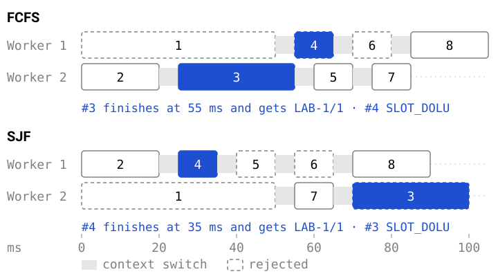

## Goal

A server that processes simultaneous requests for room, lab and GPU slots during registration week with a limited number of workers, plus a web interface that uses it. A request takes effect when its work finishes, so the scheduling policy can change which user ends up with a slot.

## Simulation mode

A deterministic event loop in virtual time. Time jumps from one event to the next: request arrivals and the ends of slices running on workers. The same input always gives the same output.

```pipeline
Finished slices | resolve, in number order
New requests | join the ready queue
Unfinished RR work | back of the queue
Idle workers | take a request by policy
```

- **Policies:** FCFS, SJF, priority with aging, and RR. Each picks with a single sort key; ties are broken by arrival time and request number.
- **Context switches:** A worker moving to a different request first waits for the switch time. Taking back the same request costs nothing.
- **Rules:** Quotas, packages (two or three slots together or none), cancellation and a fixed validation order.



## Live mode

Real threads sharing one reservation state.

- **Fine-grained locks:** One lock per user (guards the quota) and one per slot (guards its owner). There is no global lock; requests for different users and slots never wait for each other.
- **No deadlocks:** Every thread takes its locks in the same global order: the user first, then slots sorted by `(resource, slot)`. That order makes a circular wait impossible.
- **Work outside the locks:** The processing delay happens while holding no lock; locks are taken only to update the state.
- **Log check:** The sequence number is assigned while the locks are held. Replaying the log in that order on a single thread must reproduce every result; if it does not, the check reports the mismatch line by line.

In the race scenario all 72 requests arrive at once and take equally long. The operating system decides which thread gets a lock first, so the number of accepted requests changes from run to run (45 to 72 with 8 workers), but the log is consistent every time.

## Interface and tests

- The Flask interface shows a worker timeline, the queue and slot owners at a chosen moment, a request table, the four policies side by side and a live-mode panel. The browser holds no rules; everything is computed on the server.
- The command line and the interface call the same server package. The command line needs only the standard library.
- Tests reproduce the assignment's sample table exactly, compare every scenario with its expected output, and check that live mode terminates, keeps its log consistent and runs independent requests in parallel.
