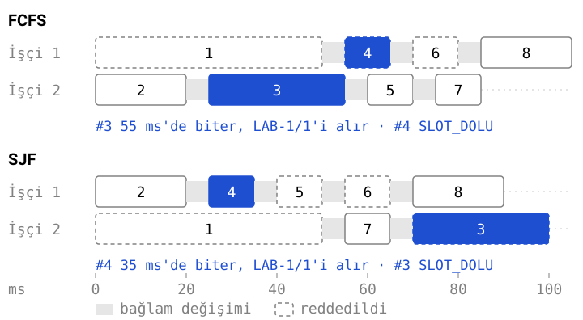

## Amaç

Kayıt haftasında oda, laboratuvar ve GPU slotları için aynı anda gelen talepleri sınırlı sayıda işçiyle işleyen bir sunucu ve onu kullanan bir web arayüzü. Talebin etkisi işi bittiği anda uygulandığı için zamanlama politikası, aynı slotu hangi kullanıcının alacağını değiştirebiliyor.

## Simülasyon modu

Sanal zamanlı, deterministik bir olay döngüsü. Zaman bir olay anından sonrakine atlıyor: talep varışları ve işçilerdeki parçaların bitişi. Aynı girdi her zaman aynı çıktıyı veriyor.

```pipeline
Biten parçalar | sonuçlanır, numara sırasıyla
Yeni talepler | hazır kuyruğa girer
RR'de bitmeyenler | kuyruğun sonuna
Boş işçiler | politikaya göre talep alır
```

- **Politikalar:** FCFS, SJF, yaşlanmalı öncelik ve RR. Hepsi tek bir sıralama anahtarıyla seçiliyor, eşitlikler varış zamanı ve numarayla bozuluyor.
- **Bağlam değişimi:** Başka bir talebe geçen işçi önce bağlam süresi kadar bekliyor. Aynı talebi geri alırsa beklemiyor.
- **Kurallar:** Kota, paket (iki veya üç slot birlikte ya da hiçbiri), iptal ve sabit bir doğrulama sırası.



## Canlı mod

Gerçek iş parçacıkları ve ortak rezervasyon durumu.

- **İnce taneli kilitler:** Her kullanıcı için bir kilit (kotayı korur) ve her slot için bir kilit (sahibini korur). Genel bir kilit yok; farklı kullanıcı ve slotlara giden talepler birbirini beklemiyor.
- **Kilitlenme yok:** Her iş parçacığı kilitleri aynı global sırayla alıyor: önce kullanıcı, sonra slotlar `(kaynak, slot)` sırasıyla. Döngüsel bekleme bu sırayla imkânsız.
- **İşlem süresi kilitsiz:** Bekleme hiçbir kilit tutulmadan yapılıyor, kilit sadece durumu güncellerken alınıyor.
- **Günlük denetimi:** Sıra numarası kilitler tutulurken veriliyor. Günlük tek iş parçacığında bu sırayla yeniden oynatılınca her sonuç aynen çıkmak zorunda; çıkmazsa denetim hatayı satır satır gösteriyor.

Yarış senaryosunda 72 talebin hepsi aynı anda geliyor ve aynı sürüyor. Hangi iş parçacığının kilidi önce alacağına işletim sistemi karar verdiği için kabul sayısı çalıştırmadan çalıştırmaya değişiyor (8 işçiyle 45 ile 72 arası), ama günlük her çalıştırmada tutarlı.

## Arayüz ve testler

- Flask arayüzünde işçi zaman çizelgesi, seçilen andaki kuyruk ve slot sahipleri, talep tablosu, dört politikanın yan yana karşılaştırması ve canlı mod paneli var. Tarayıcıda kural yok, her hesap sunucuda.
- Komut satırı ve arayüz aynı sunucu paketini çağırıyor. Komut satırı sadece standart kütüphaneyle çalışıyor.
- Testler ödevdeki örnek tabloyu birebir doğruluyor; her senaryo beklenen çıktıyla karşılaştırılıyor; canlı modda sonlanma, günlük tutarlılığı ve bağımsız taleplerin paralel çalıştığı test ediliyor.
