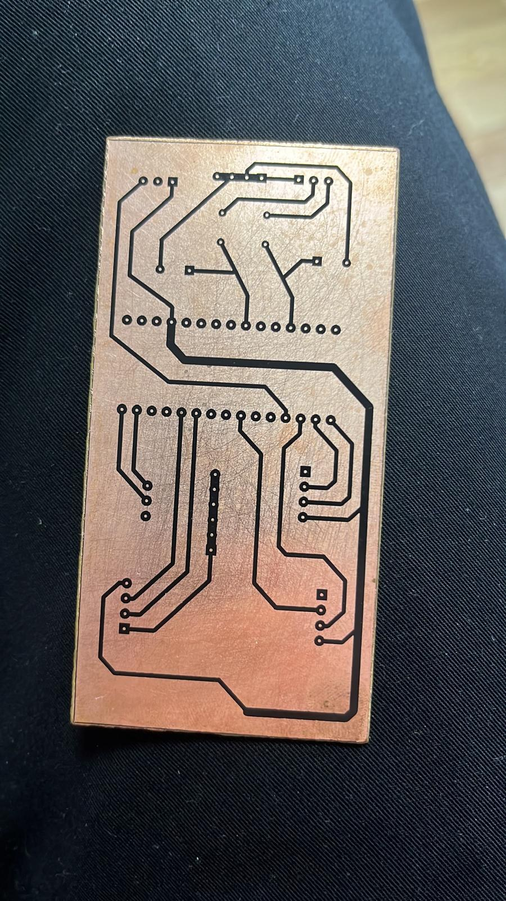
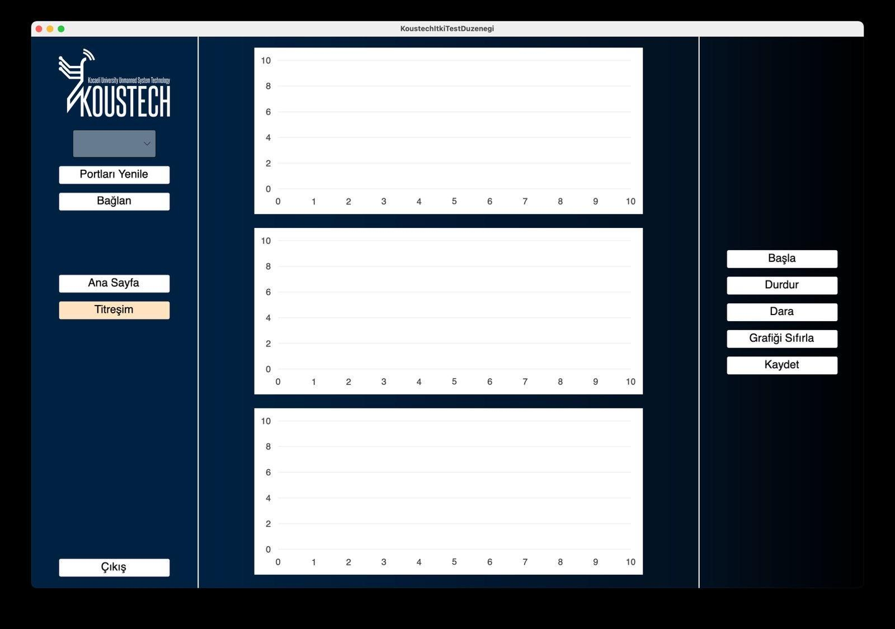

## Goal

Measure the thrust, efficiency and vibration of brushless motor and propeller combinations so that the team picks motors and propellers based on data.

## Architecture

```pipeline
Sensors | load cell + HX711 (24-bit ADC), MPU6050, power module
STM32F3 Nucleo | custom PCB, firmware
UART | timestamped, CRC-checked frames
Desktop GUI | Python, PySide6, Matplotlib
```



## What I did

- Designed the stand's board in KiCad; it was my first PCB design.
- Wrote a bit-banged HX711 driver: 24 clock pulses shift out the 24-bit reading, and the 25th pulse selects channel A with gain 128 for the next conversion.
- Developed the STM32F3 firmware that reads vibration from the MPU6050 over I2C and analog current/voltage from the power module.
- Designed my own frame format for the UART link to the PC: timestamp, measurements and a CRC to catch corrupted frames.
- The analog current/voltage readings were very noisy. To find out whether the bug was in my code or in the signal, I spent a few weeks between the oscilloscope and the debugger; the noise was in the signal, and low-pass filtering brought it down to an acceptable error.
- Wrote a desktop GUI in Python, PySide6 and Matplotlib that receives the frames over UART and plots them in real time.




