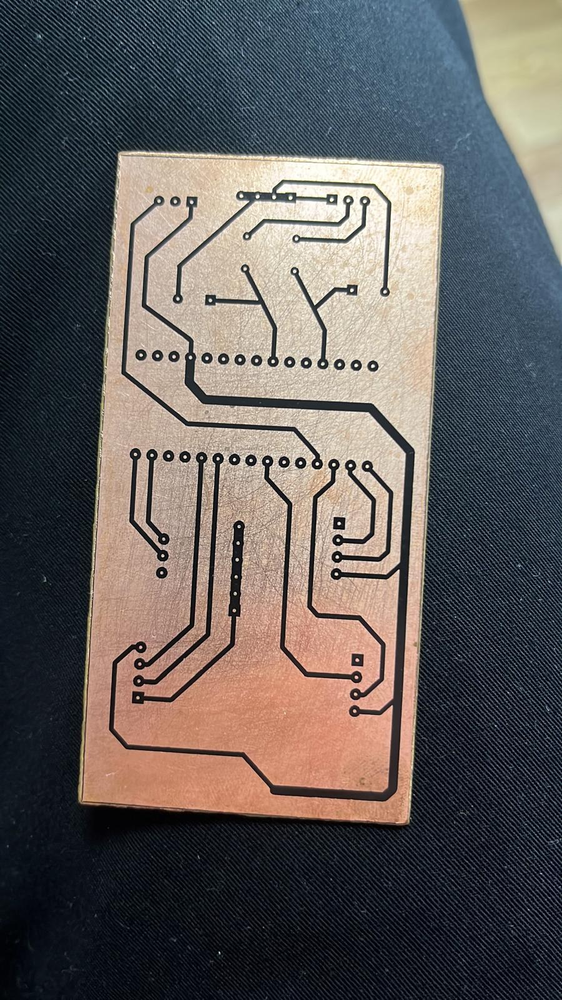
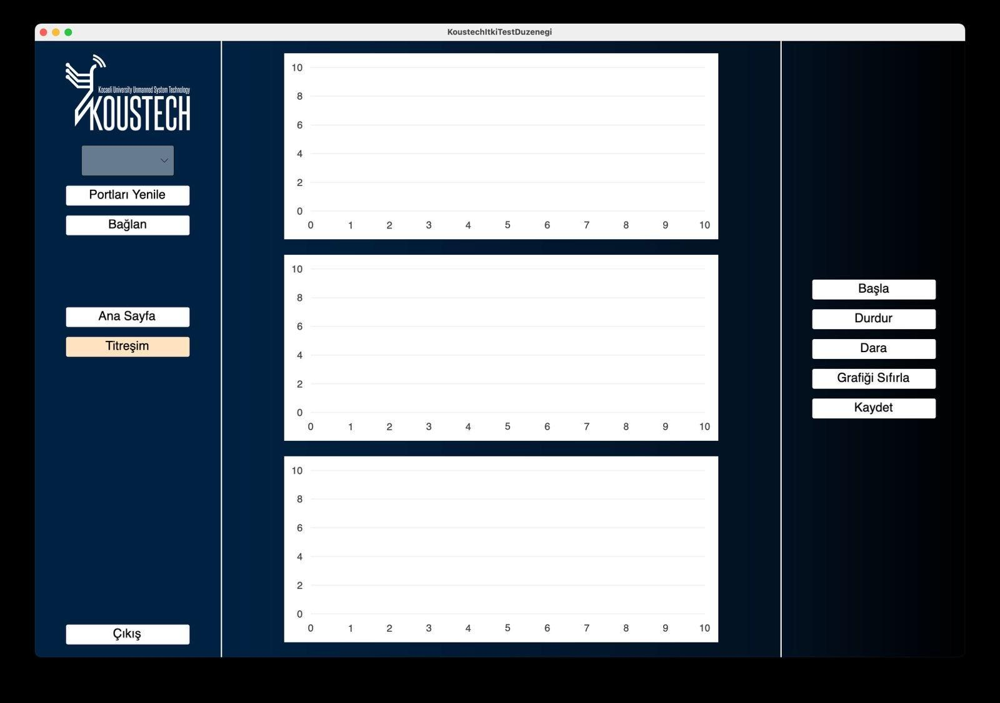

## Amaç

Fırçasız motor ve pervane kombinasyonlarının itkisini, verimini ve titreşimini ölçmek. Böylece takım motor ve pervane seçimini veriye dayanarak yapabilir.

## Mimari

```pipeline
Sensörler | yük hücresi + HX711 (24 bit ADC), MPU6050, güç modülü
STM32F3 Nucleo | özel PCB, firmware
UART | zaman damgalı, CRC'li çerçeveler
Masaüstü arayüz | Python, PySide6, Matplotlib
```



## Ne yaptım

- Standın kartını KiCad'de tasarladım. İlk PCB tasarımımdı.
- Bit-banged bir HX711 sürücüsü yazdım: 24 saat darbesi 24 bitlik okumayı dışarı kaydırıyor, 25. darbe bir sonraki dönüşüm için kanal A'yı ve 128 kazancını seçiyor.
- MPU6050'den I2C ile titreşimi, güç modülünden analog akım/gerilimi okuyan STM32F3 firmware'ini geliştirdim.
- Bilgisayara giden UART bağlantısı için kendi çerçeve formatımı tasarladım: zaman damgası, ölçümler ve bozuk çerçeveleri yakalamak için bir CRC.
- Analog akım/gerilim okumaları çok gürültülüydü. Hatanın kodumda mı sinyalde mi olduğunu bulmak için birkaç haftamı osiloskop ile debugger arasında geçirdim. Gürültü sinyaldeydi, alçak geçiren filtre ile kabul edilebilir bir hataya indirdim.
- UART üzerinden çerçeveleri alıp gerçek zamanlı çizen bir masaüstü arayüzü yazdım (Python, PySide6, Matplotlib).




