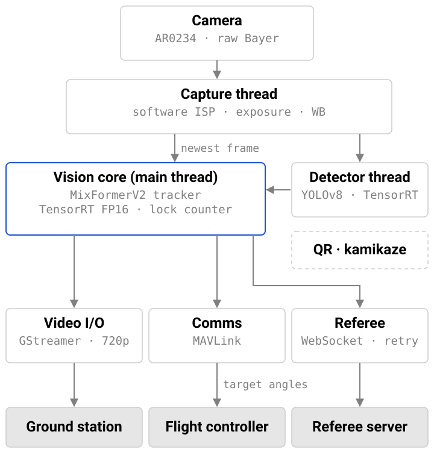

## Goal

Run onboard target detection and tracking in real time, keep the QR-coded ground target readable in any lighting, and this season, connect all vehicles on a shared network.

## Architecture



- The camera delivers raw Bayer data. The capture thread debayers it and handles exposure and white balance in a software ISP, then drops the frame into a single slot. If the tracker slows down, no queue builds up: the newest frame wins.
- The tracker (MixFormerV2) runs on the main thread and the YOLOv8 detector on its own thread. The detector publishes its latest box and the tracker takes the target from there.
- Outputs: 720p video to the ground station over GStreamer, the target's azimuth and elevation (radians) to the flight controller as MAVLink `DEBUG_VECT`, and lock notifications to the referee server over WebSocket.

## Performance (Jun – Sep 2026)

- Converted the YOLO model and the tracker to TensorRT and moved the whole system to FP16. The two engines run on separate CUDA streams.
- The tracker rebuilt its input tensors on every frame. I replaced them with pinned buffers allocated once per role (template, online template, search), with copies going over async DMA. This stopped the periodic drops to about 40 FPS.
- Merged five separate GPU → CPU synchronisations per frame into one.
- The BGR → RGB conversion now runs on the cropped region instead of the whole frame, and an unused attention mask is no longer allocated.

```bars max=60 Frame-to-frame time measured with time.perf_counter. The camera runs at 60 FPS, so about 60 FPS is the ceiling.
Baseline (no TensorRT) | 13 | 12–14 FPS
YOLO on TensorRT (FP32) | 25 | ~25 FPS
YOLO + tracker on TensorRT (FP32) | 37.5 | 35–40 FPS
Both on FP16 | 55 | 50–60, drops to ~40
+ persistent buffers, one sync | 57.5 | stable ~55–60 FPS | *
```

## Camera and optics (Jun – Sep 2026)

- Selected the camera sensor (AR0234), lens and filter.
- The competition's QR-coded target lies on the ground on a tarp and reflects the sun around midday, a problem for many teams. After researching it, I fitted a circular polarizing (CPL) filter: light reflected from non-metallic surfaces is largely polarized, so the filter suppresses the glare. Our team never had the problem.

## This season: batman-adv mesh network (in progress)

I am building a single mesh network for all of the team's air and ground vehicles. batman-adv is a layer-2 mesh protocol that runs in the Linux kernel; vehicles share one network and can relay traffic for each other.
