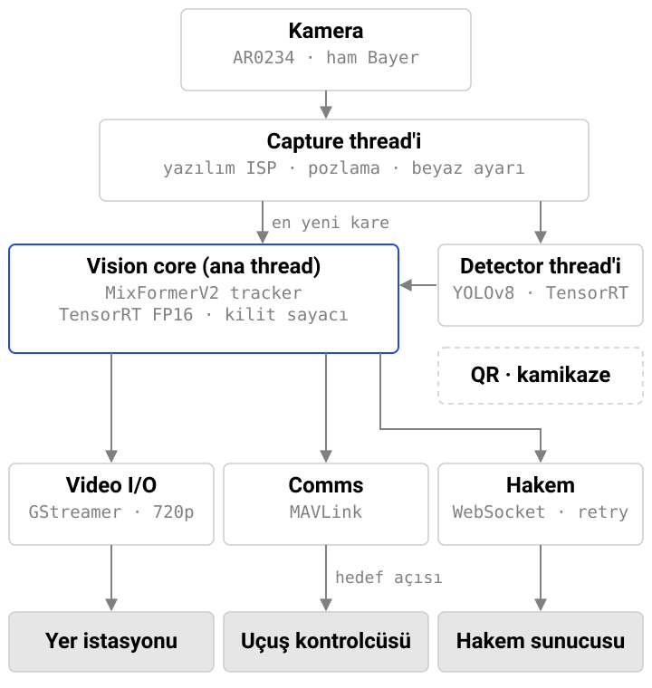

## Amaç

Hedef tespitini ve takibini araç üzerinde gerçek zamanlı çalıştırmak, QR kodlu yer hedefini her ışıkta okunur tutmak ve bu sezon tüm araçları ortak bir ağa bağlamak.

## Mimari



- Kamera ham Bayer veri veriyor. Capture thread'i yazılım ISP'siyle debayer, pozlama ve beyaz ayarını yapıp kareyi tek kişilik bir yuvaya bırakıyor. Tracker yavaşlarsa kuyruk birikmiyor, en yeni kare kazanıyor.
- Tracker (MixFormerV2) ana thread'de, YOLOv8 dedektörü ayrı bir thread'de çalışıyor. Dedektör son bulduğu kutuyu bırakıyor, tracker hedefi oradan alıyor.
- Çıktılar: yer istasyonuna GStreamer ile 720p video, uçuş kontrolcüsüne MAVLink `DEBUG_VECT` ile hedefin azimut ve elevasyon açısı (radyan), hakem sunucusuna WebSocket ile kilitlenme bildirimi.

## Performans (Haziran – Eylül 2026)

- YOLO modelini ve tracker'ı TensorRT'ye çevirdim, tüm sistemi FP16'ya taşıdım. İki motor ayrı CUDA stream'lerinde çalışıyor.
- Tracker her karede girdi tensörlerini yeniden kuruyordu. Bunları rol başına (template, online template, search) bir kez ayrılan pinned bellek alanlarıyla değiştirdim, kopyalar asenkron DMA ile gidiyor. Periyodik olarak 40 FPS'e düşmeler bitti.
- Kare başına beş ayrı GPU → CPU senkronizasyonunu tek bir senkronizasyonda birleştirdim.
- Renk dönüşümünü (BGR → RGB) tüm kare yerine sadece kırpılmış bölgede yapıyorum. Kullanılmayan attention mask artık ayrılmıyor.

```bars max=60 Kareden kareye süre time.perf_counter ile ölçüldü. Kamera 60 FPS, yani tavan yaklaşık 60 FPS.
Başlangıç (TensorRT yok) | 13 | 12–14 FPS
YOLO TensorRT'de (FP32) | 25 | ~25 FPS
YOLO + tracker TensorRT'de (FP32) | 37.5 | 35–40 FPS
İkisi de FP16 | 55 | 50–60, ~40'a düşüyor
+ kalıcı bellek, tek senkronizasyon | 57.5 | kararlı ~55–60 FPS | *
```

## Kamera ve optik (Haziran – Eylül 2026)

- Kamera sensörünü (AR0234), lensi ve filtreyi seçtim.
- Yarışmanın QR kodlu hedefi yerde bir branda üzerinde duruyor ve öğle saatlerinde güneşi yansıtıyor. Bu birçok takım için sorun oldu. Araştırdıktan sonra dairesel polarize (CPL) filtre taktım: metal olmayan yüzeylerden yansıyan ışık büyük ölçüde polarize olduğu için filtre parlamayı bastırıyor. Bizim takım bu sorunu hiç yaşamadı.

## Bu sezon: batman-adv mesh ağı (devam ediyor)

Takımın tüm hava ve kara araçları için tek bir mesh ağ kuruyorum. batman-adv, Linux kernel'inde çalışan bir katman 2 mesh protokolü. Araçlar tek bir ağı paylaşıyor ve birbirlerinin trafiğini aktarabiliyor.
